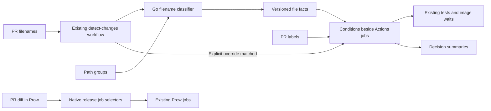
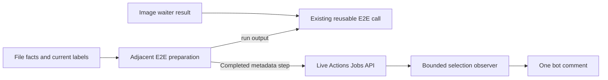

# Job-local native CI selection

Each Actions job decides whether it needs to run. Its condition combines changed-file facts with PR labels. Prow makes automatic scheduling decisions through path selectors in `openshift/release`. No runtime program produces a list of jobs.

This is a discussion prototype. It exercises 31 Actions job/helper targets: the 29 from [PR #23403 at `34873a53e3b6`](https://github.com/stackrox/stackrox/commit/34873a53e3b60b5fc7b50b1446b02d11a1eb0fca), plus the current base's Konflux database backup/restore variant and focused roxvet tests. Actions preserves the saved E2E dispatch behavior after mapping the ordinary backup/restore job and label to their GKE names. Candidate differences cover explicit build-input overrides, generated-file verification, and excluding CI-only Go from ACS checks. **Prow does not have equivalent behavior.** The differences and concrete examples are in [cases.md](cases.md).

The [Granular Test Proposal](https://docs.google.com/document/d/1rpe0LZu39BLq9X_jUYH3iEWVmjqxkzIstQ8nwvMRv1I/edit) and [original CI design](https://docs.google.com/document/d/1qYJFtJr7_19X9nPliYgClDs-nNRRYA8FPe1bAg04jN0/edit) supply background proposals. Their unimplemented extensions are not attributed to the pinned comparison.

## Where to edit a rule

| Concern | Owning file |
| --- | --- |
| Go, PostgreSQL, Sensor integration, benchmarks, UI, shell, local roxctl | [unit-tests.yaml](../../.github/workflows/unit-tests.yaml), the job's `Explain selection` input |
| Style, generated files, Go/Actions/Prow lint, dependent image versions | [style.yaml](../../.github/workflows/style.yaml), the job's `Explain selection` input |
| Operator/CRD and Scanner database tests | [check-crd-compatibility.yaml](../../.github/workflows/check-crd-compatibility.yaml), [scanner-db-integration-tests.yaml](../../.github/workflows/scanner-db-integration-tests.yaml) |
| Nine Actions E2E consumers | [e2e-dispatch.yaml](../../.github/workflows/e2e-dispatch.yaml), each adjacent `select-e2e-…` job's `Explain selection` inputs |
| Image waits and their dependent jobs | The two waiter jobs in `e2e-dispatch.yaml`; advisory `explain-image-build-selection` job in [build.yaml](../../.github/workflows/build.yaml) |
| Native-selector and roxvet tests | [native-ci-tests.yaml](../../.github/workflows/native-ci-tests.yaml), each job's `Explain selection` input |
| Definitions of named filename groups | [file-groups.json](file-groups.json); these contain paths, never jobs or labels |
| Prow automatic scheduling | [prow/native-selection.patch](prow/native-selection.patch), an **unapplied** patch to external source configuration |

For example, PostgreSQL selects a candidate for a Central-only diff, a shared communication change, `area/central`, or a broad dependency/interface change. Its native expression contains those alternatives beside `go-postgres`. Adding an unrelated file can invalidate the Central-only alternative; a matching shared file or label can still select it.

## Runtime structure



The detector remains the only Actions file collector, once per calling workflow. Its existing `files` and `ui_only` outputs still support the existing outer conditions. They cannot express the comparison's other positive every-file predicates, such as Scanner-only or Central-only. [file-facts/main.go](file-facts/main.go) provides that missing classification using Go's standard library. There are no new Python or Bash programs or runtime dependencies.

Classification adds a checkout, Go setup and compilation to each calling workflow. This overhead is a cost of the prototype; no once-per-PR cache or measured runtime saving is claimed.

The classifier accepts one JSON object on stdin: `{"base":"…","head":"…","files":["ui/package.json"]}`. `--groups` defaults to `ci/native-selectors/file-groups.json`, a JSON object mapping group names to `include` and optional `exclude` arrays of Go regular expressions. A filename matches when any inclusion matches and no exclusion matches. Exclusions apply per file, so a CI file cannot hide an ACS file in a mixed diff. Stdout is one JSON object: `{"version":1,"complete":true,"base":"…","head":"…","any":["ui"],"every":["ui"]}`. Empty diffs match no group. Invalid input or expressions cause a nonzero exit and no facts. The classifier has no Git/API access and knows nothing about labels, job names, dependencies, or dispatch.

The reusable detector exposes this as `facts`. API, checkout, compilation, or classification failure supplies `{"version":1,"complete":false,"any":[],"every":[]}`. It validates the event's head/base, paginates, and includes both rename paths. Multiline filenames, 3,000 or more collected paths, and oversized output use the unavailable-data fallback.

The detector also exposes `run_all`: `true` when validated filenames match a calling workflow's explicit `run_all` input; otherwise empty. The unit workflow retains overrides for `Makefile`, `make/`, and `.github/actions/job-preamble/`. Editing the detector or unit workflow does not request all native candidates: the `selector` file fact selects regression tests instead. The detector retains empty legacy `files`/`ui_only` outputs on its own edits for existing callers, while native jobs receive complete facts. Explicit build-input matches take precedence even when the detector also changes. Collection failures retain the documented per-job defaults.

Go and generated-file selection excludes `ci/` and `tools/roxvet/`. Interface/CRD fixtures in those trees also remain CI inputs. Native-selector code runs the classifier, expression, and reporter tests; roxvet code runs `go test ./tools/roxvet/...` and `go vet ./tools/roxvet/...`. Other Go tooling remains conservatively included in ACS checks because generators can affect product code. CI-only changes do not select E2E or a representative E2E job. Product/shared-input matches and explicit requests retain their own native rules.

## How execution works

Without `ci-dispatcher-enforce`, Actions reports decisions and retains existing per-run test eligibility. With that label, native conditions apply selection. Ordinary jobs retain their check names and matrices; expensive steps become successful no-ops when unselected. Existing outer conditions still apply. Style remains selected. Jobs outside the comparison inventory retain their behavior.

E2E consumers keep their existing reusable workflows. Each consumer owns its native condition; `should-dispatch` only reads current labels and reports its own prerequisite candidacy. It exports no per-job plan. Consumers require a successful image waiter that permits execution. Waiters include the union of their consumers' rules. This duplication is necessary because Actions does not infer prerequisites from selected consumers.

Each E2E call has an adjacent `select-e2e-…` preparation job. It runs after file detection and label refresh, without waiting for images, and records the native candidate and execution restrictions through the explanation action. Its single `run` output controls that call's existing `should-run` input. The call still requires its images and successful preparation. An early permission record can therefore be followed by a skipped call if an image prerequisite fails; permission does not confirm execution.

This adds nine runner starts and a prerequisite failure point. Preparations check out only the explanation action. A preparation failure blocks its call. Queueing can delay both the decision and the dependent call.



Image builds **always remain enabled**. The separate `explain-image-build-selection` job reports candidacy but does not enforce it: the comparison's dependency graph does not account for Prow and manual image consumers. Image production has no dependency on the detector or advisory report. The execution scripts, build matrices, and child test workflows are unchanged.

`ci-run-all-tests` selects enrolled Actions candidates when classification succeeds. It does not bypass existing outer conditions, authorize forks, supply Konflux images, schedule Prow jobs, or choose the full QA test group. `ci-all-qa-tests` retains its separate role inside an already-running QA job. On classification failure, the comparison's defaults take precedence: the three Actions QA/FIPS E2E candidates skip; other enrolled Actions candidates run.

Enforced E2E selection can run a selected same-repository draft, as in #23403. Forks remain blocked. Enforced Konflux consumers require `konflux-build`, even with an explicit job label. Outside enforcement, legacy draft/label/image rules remain. Waiters now also reject forks explicitly, matching the comparison; the old dispatcher could wait for ordinary images on a ready fork without dispatching tests.

Label add/remove events reevaluate the selectable test workflows. This can restart work, including in shadow mode. Build keeps its original triggers because its images are retained; adding a label does not create another image build. Ordinary jobs use event labels, so rerunning an old event retains that event's labels. E2E refreshes current labels at the same head; refresh failure disables enforcement and uses event labels for legacy eligibility. [The cases](cases.md) explain this difference.

Decision summaries print already-evaluated candidates and permission to execute. The E2E report prints existing workflow results. Neither recomputes selection rules or claims tests ran from a successful wrapper/no-op check.

A single [selection observer](selection-report/README.md) starts alongside CI, without test dependencies. For ten minutes it checks the live Actions Jobs API every five seconds and updates one bot comment when records change. Each explanation exposes its already-evaluated outputs in a metadata-only step name, so the observer can read a decision while the test job is still running. It never evaluates selection rules. The comment reports Allow or Skip from each recorded selection rule, with the requested Enforce/Shadow mode above the table. Execution restrictions stay in the linked job summaries; pending and unavailable records remain explicit. It contains no timing measurement or commit history.

This experiment publishes only on same-repository PR #23602; local commands preview only. Runner startup, API latency, and queueing affect visibility. Decisions made after the bounded window require an observer rerun. Jobs skipped before any explanation have no record and cannot be classified from their status alone. [The observer guide](selection-report/README.md) describes these limits and its metadata interface.

## Validation

From the repository root, with Go 1.26.7, Git, jq, and Bash 4 or newer:

```sh
go -C ci/native-selectors/testing test -count=1 -v ./...
go -C ci/native-selectors/testing vet ./...
```

On macOS, set `NATIVE_TEST_BASH=/opt/homebrew/bin/bash` if necessary. Go tests build the classifier and use `act`'s Go expression evaluator against the actual workflow conditions. The three saved comparison fixtures remain unchanged. Of 2,175 PR candidate comparisons across the 29 reference targets, 2,152 retain the pinned result, with 21 intentional additions and 2 removals. All 83 saved E2E dispatch/waiter scenarios retain their results after the GKE name mapping. Twenty additional scenarios cover both current backup/restore variants and their image prerequisites. Fifteen tooling scenarios cover CI-only changes, mixed product inputs, explicit requests, and the prototype PR's file mix. Tests also check the actual classifier step and output mapping, explicit overrides, step gates, required-context structure, four actual build-matrix constructions, collector failures, label refresh, and selector-only external edits. Test dependencies live in a separate module; no verifier selects product jobs at runtime.

[The testing guide](testing/README.md) describes the test files and the known empty-label discrepancy between GitHub's expression library and `act`. It includes an expression that returns different results. The tests do not treat the evaluators as fully equivalent.

The optional focused Prow experiment uses the five unmodified matcher methods from the revision recorded in `prow/source.json`:

```sh
NATIVE_PROW_JOBS_GO=/path/to/pinned/prow/pkg/config/jobs.go go -C ci/native-selectors/testing test -count=1 -v ./...
```

Executed locally: those comparisons, 16 upstream matcher cases, focused repository-selected actionlint, Go build/vet and configured golangci-lint including unused checks, and whitespace checks. No CI time or cost savings were measured.

Real CI is still needed to exercise label deliveries/reruns, draft/fork approvals, exact matrix and reusable-workflow check reporting, image availability, Prow generated configuration checks/rehearsals, `/test`, `/test all`, and `/retest` routing, and actual test execution across the documented scenarios. The external patch remains unapplied.
