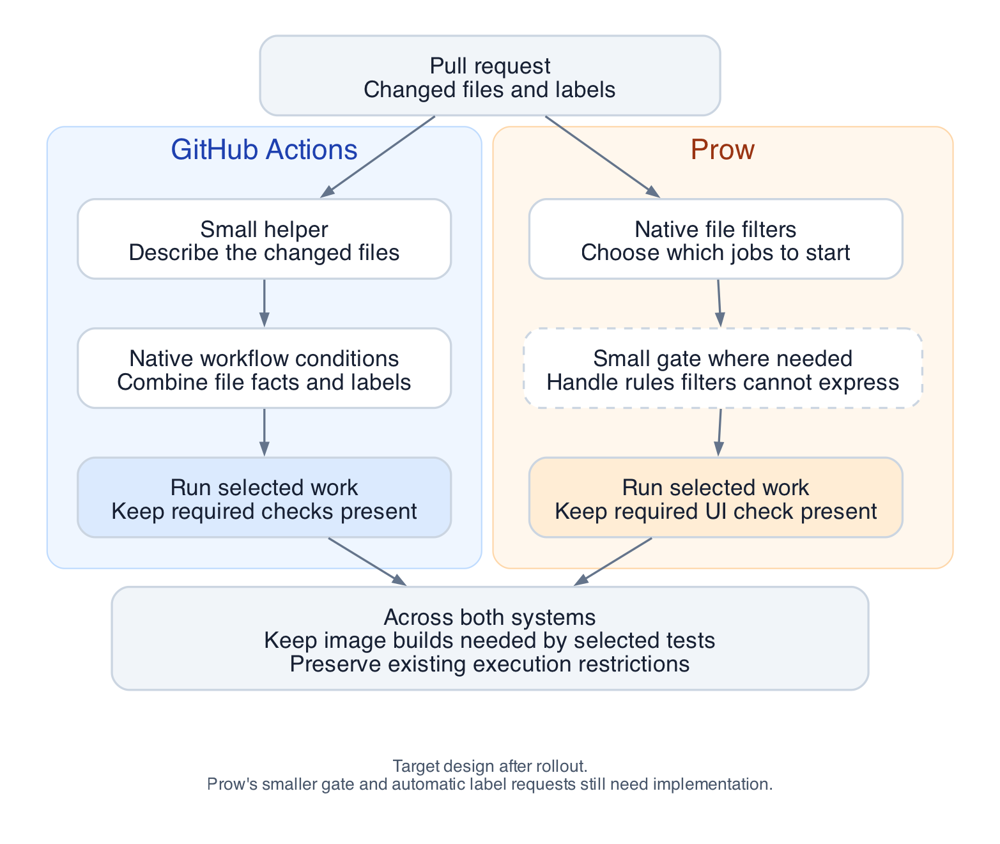

# Running the right CI tests for each pull request

**Design for discussion.** This document explains an alternative to the shared CI resolver proposed in PR #23403. It describes the recommended design and identifies what still needs implementation or validation.

The *comparison prototype* means the implementation of PR #23403 at the fixed commit listed under References. Its selection rules are the baseline for this comparison.

## Recommendation

Use GitHub Actions and Prow's built-in rules wherever they fit. Keep a small amount of custom code for the decisions those rules cannot express.

GitHub Actions can handle most of the comparison prototype's selection rules with workflow conditions and a helper that reads changed files. Prow can use file filters to avoid starting unnecessary jobs, but it needs additional handling for some labels, shadow mode (showing selection decisions without changing existing test execution), and required checks. The two systems do not need identical implementations.

This approach is worth testing before adopting a general shared resolver. It reduces custom decision-making code, but it does not eliminate configuration or coordination between the two CI systems.

## The problem we are solving

A pull request does not always need every CI test. A UI change, a shared Go library change, and an update to dependencies have different testing needs. Developers must also be able to request extra coverage when the automatic choice is too narrow.

A *job* is one unit of CI work, such as Go unit tests, an image build, or tests against a running cluster. StackRox runs jobs in two systems: **GitHub Actions** and **Prow**, which runs OpenShift CI jobs.

The proposed shared *resolver* is a program that reads the changed files and labels, then produces a list of jobs to run. The alternative described here puts most of those decisions in the CI systems' existing configuration. We call these *native rules* because the CI platform evaluates them.

Choosing tests also means keeping their prerequisites and reporting the results GitHub expects. Skipping a test is useful only if it does not break another job or leave a pull request waiting for a check that will never appear.

## How the design works



*The diagram shows the target design. The smaller Prow gate and automatic handling of label requests are proposed additions, not completed parts of the native prototype.*

### GitHub Actions: collect file facts, then use workflow conditions

A small helper reads the changed files and answers questions such as “Did any Go file change?” and “Are all changed files under `ui/`?” It does not choose jobs.

The workflows combine those answers with PR labels. For example, a change to `pkg/concurrency/context.go` selects Go checks and tests for both Central's database behavior and Sensor integration. A change to `go.mod` selects the broader set covered by those rules.

Dependencies remain explicit. If a selected test needs an image, the configuration must also keep the image build and any wait for that image. Existing restrictions still apply: selecting a job does not grant a fork access to credentials or make a missing image available.

The prototype implements this approach. It also produces a workflow summary showing the file facts and selected jobs, so a developer can inspect a decision.

### Prow: avoid scheduling work where possible

Prow can decide whether to start a job from the changed paths. This saves work earlier than starting a job and having it exit immediately.

For example, the existing GKE QA job can use a filter for changes to dependencies and generated interfaces: `go.mod`, `go.sum`, `proto/`, `generated/`, and `.proto` files. Those paths come from the comparison prototype's selection rules. They are not a proposed definition of sufficient QA coverage for production.

For rules that Prow cannot express, retain a small *gate*: code at the start of an already-scheduled job that decides whether to execute its tests. This is useful for the required UI job and while evaluating selection in shadow mode. It still costs a job start and may run after some environment setup.

Initially, keep jobs that currently require a manual request manual. Automatically starting more jobs is a separate behavior change, even if the selection rules include them.

## Two safeguards

### A skipped test must not leave a missing required check

GitHub requires named checks before a PR can merge. There is a difference between a job reporting that it was skipped and a job never creating its check.

The explanation shown to developers must distinguish skipped work from tests that ran and passed, even when both satisfy a required check.

In Actions, the prototype preserves the required job names. For jobs with several variants, such as different build architectures, it skips the expensive steps while keeping the variants present. This uses some runner time but avoids losing required checks.

The Prow UI check is also required. The native prototype keeps that job running. A smaller gate could later skip its test work while still reporting a result. Making the entire job disappear would require a coordinated change to GitHub's requirements.

### Tests must keep the images they use

Some Prow tests use images built by GitHub Actions. Each system cannot decide independently that the other's prerequisites are unnecessary.

The prototype therefore keeps image builds enabled, even when its selection calculation says they could be skipped. Before changing that, we need to identify every test that consumes those images and ensure that selecting it also keeps its builds. Until then, expected savings exclude these image builds.

## What developers would do

For normal PR updates, CI evaluates the changed files and labels. In the Actions prototype, PRs without `ci-dispatcher-enforce` use shadow mode: CI shows its selection decisions but keeps existing test execution. Adding that label enables enforcement, so CI applies the decisions to skip unselected work, subject to existing execution restrictions. Developers can request extra work using the existing controls:

- **Actions job labels**, such as `e2e-byodb-tests`, request specific jobs, subject to existing restrictions.
- **`ci-run-all-tests`** selects all jobs covered by the selection rules when enforcement is enabled. It does not mean every job in StackRox, bypass execution restrictions, or automatically start every manual Prow job.
- **Explicit Prow comments**, such as `/test gke-qa-e2e-tests`, request a named job even when its native path filter would exclude it. Prow's trust rules still apply. `/test all` continues to respect conditional selection and is not equivalent to explicitly requesting every job.

`ci-all-qa-tests` has a different purpose: it requests the full QA test set inside a QA job that is already running, instead of the usual smaller PR test set. It does not start that job by itself.

Actions can reevaluate selection when labels are added or removed. Prow does not automatically interpret our CI labels this way. Preserving automatic label requests after introducing Prow file filters would require a *bridge*: a small trusted service that turns labels into explicit Prow requests. It must avoid duplicate requests and distinguish tests that actually ran from jobs that reported a successful skip. The current helper only prints proposed commands.

## Where the two systems differ

Two differences matter enough to keep visible in the design.

**Prow cannot express every existing file rule with its native filters.** For example, the comparison prototype selects `gke-ui-e2e-tests` when every changed file is under `ui/`. With no labels requesting extra tests, these two PRs produce different decisions:

| Changed files | Comparison prototype selects UI tests? | Native `run_if_changed: ^ui/` selects UI tests? |
| --- | --- | --- |
| `ui/package.json` | Yes | Yes |
| `ui/package.json` and `OWNERS` | No | Yes |

The native filter still finds a UI file in the second PR. Changing the regex cannot make an existing match disappear when an unrelated file is added. The other native filter, `skip_if_only_changed`, skips a job when every file matches; it cannot express “run only when every file matches.” See [Prow's file-filter semantics](https://docs.prow.k8s.io/docs/jobs/#triggering-jobs-based-on-changes).

Keeping the same selection rules requires a gate inside a scheduled job. Selecting UI tests for both PRs is also possible, but broadens the selection rules. This example explains a difference from the comparison prototype; it does not recommend skipping UI tests merely because an unrelated file changed.

**Prow file filters alone cannot switch individual PRs between shadow mode and enforcement.** Shadow mode (showing what would run or be skipped without applying those decisions) lets us evaluate selection while keeping existing test execution. The intended switch is the PR label `ci-dispatcher-enforce`: without it, selection stays in shadow mode; with it, the decisions are enforced.

Consider a normal same-repository PR that changes only `README.md`, with no manual test request or run-all label. Existing Prow scheduling starts `gke-qa-e2e-tests`, but the comparison prototype does not select that suite. The desired behavior is:

| PR label | Mode | What should happen to QA tests? |
| --- | --- | --- |
| No `ci-dispatcher-enforce` | Shadow mode | Report “QA would be skipped,” but run the tests. |
| `ci-dispatcher-enforce` present | Enforcement | Report the decision and skip the test work. |

A native QA filter matching dependency and interface paths, such as `go.mod` and `proto/`, excludes the README change in **both** cases. It does not inspect the enforcement label. The job never starts, so a gate inside it cannot report the decision and run the tests as shadow mode requires.

To support both rows, keep existing scheduling while shadow mode is needed and let a gate inside the job read the label. Introduce narrower native filters only after deciding to enforce them for all PRs covered by that configuration. Switching between shadow mode and enforcement remains possible with this additional mechanism; static file filters alone cannot provide it.

These are reasons to combine native rules with limited custom handling. They do not show that native selection is generally unusable.

## A staged rollout

1. **Validate Actions in shadow mode.** Compare its decisions with the resolver while retaining existing test execution. Then add `ci-dispatcher-enforce` to selected PRs to test enforcement, including label changes, drafts, forks, and reruns.
2. **Validate Prow without narrowing scheduling.** Keep the required UI job and current manual-job boundaries. Evaluate the gate and explicit test requests, then decide how labels should request additional work.
3. **Introduce Prow file filters after the selection rules are accepted.** Rehearse the external configuration changes and verify required-check reporting. Treat automatic label requests and image-build skipping as separate changes with their own validation.

Merged changes, nightly runs, and other non-PR runs keep their existing behavior. Selecting smaller groups of tests within a job is a possible later extension, not part of this design's current scope.

## What we have demonstrated

The native Actions expressions matched the comparison prototype's selection and dispatch decisions in **83 local scenarios**. These include overlapping changes, labels, drafts, forks, shadow mode, and failure cases. Separate tests checked required job names and build variants. **12 experiments** exercised Prow's own file-matching methods.

The prototype also includes external Prow configuration patches, but they have not been deployed. The proposed smaller Prow gate and trusted label bridge are not implemented. Real CI runs still need to confirm event delivery, check reporting, image availability, and test execution. No time or cost savings have been measured.

## The decision to make

The native approach offers familiar configuration and less custom runtime logic. Its maintenance cost is duplication: some paths and job relationships must stay consistent across Actions and Prow. Every new job needs tests that check those relationships.

Actions conditions live in the StackRox repository; Prow scheduling configuration lives in `openshift/release`. A coverage change may therefore need coordinated updates in both repositories.

A shared resolver offers one place for selection rules and explanations. It becomes more attractive if we require identical behavior across both systems or introduce complex rules for selecting tests within jobs. It would still need integration with scheduling, images, and required checks.

The recommended next step is to evaluate native Actions first and a limited Prow hybrid alongside it. That gives us evidence for the smaller design before committing to a general selection system.

## References

- Comparison baseline: [PR #23403](https://github.com/stackrox/stackrox/pull/23403), commit [`34873a53e3b60b5fc7b50b1446b02d11a1eb0fca`](https://github.com/stackrox/stackrox/commit/34873a53e3b60b5fc7b50b1446b02d11a1eb0fca). Statements about its behavior refer to this revision, not later changes.
- Original context: [Granular Test Proposal](https://docs.google.com/document/d/1rpe0LZu39BLq9X_jUYH3iEWVmjqxkzIstQ8nwvMRv1I/edit) and [CI design](https://docs.google.com/document/d/1qYJFtJr7_19X9nPliYgClDs-nNRRYA8FPe1bAg04jN0/edit?tab=t.0).
- Detailed findings, configuration examples, source links, and test results: `ci/native-selectors/investigation.md` in the native-selector prototype branch. Local reproduction instructions are in `ci/native-selectors/README.md`.

## FAQ

### Why do we need a helper for changed files? Doesn't GitHub Actions already have access to the diff?

GitHub has access to the diff. **The limitation is that it does not expose the changed-file list directly to job conditions.** There are two separate mechanisms:

- **Workflow filters**, such as `on.pull_request.paths: ['ui/**']`, let GitHub decide whether to start an entire workflow. They inspect the diff without any helper. See [GitHub's path-filter documentation](https://docs.github.com/en/actions/reference/workflows-and-actions/workflow-syntax#onpushpull_requestpull_request_targetpathspaths-ignore).
- **Job conditions**, such as `jobs.ui-tests.if`, can inspect labels and outputs from earlier jobs, but have no built-in “did these paths change?” function or complete changed-file list. There is no job-level `paths:` setting. See [GitHub's available expression contexts](https://docs.github.com/en/actions/reference/workflows-and-actions/contexts#context-availability).

That matters when we want a condition such as **“run these tests when relevant files changed OR the PR has `ci-run-all-tests`.”** Putting a path filter on the entire workflow would prevent it from starting when those paths did not change. A label condition inside that workflow cannot override a decision that prevented the workflow from starting.

The proposed helper bridges that gap: an initial job obtains filenames through Git or the GitHub API, evaluates questions such as “Did any Go file change?”, and publishes the answers. Later jobs combine those answers with labels using ordinary GitHub Actions conditions. The helper does not select jobs or resolve dependencies.

**We do not necessarily need a new custom helper.** StackRox already uses this pattern in `.github/workflows/detect-changes.yml`, which fetches PR filenames through the API. Extending that helper or using an existing action are alternatives to the prototype's Python implementation. If workflow-level path filtering alone met our requirements, no helper would be necessary.

### Which concrete rules can Prow's native selectors not express?

The main gaps are below. These apply to the evaluated file selectors and standard trigger handling. A job script or additional plugin can provide behavior beyond those mechanisms.

- **“Run UI tests when every changed file is under `ui/`.”** With no labels, the comparison prototype selects `gke-ui-e2e-tests` for `ui/package.json`, but stops selecting it if `OWNERS` also changes. `run_if_changed: ^ui/` selects both cases. `skip_if_only_changed` skips when every path matches; it does not provide the opposite “run only when every path matches” rule. Preserving the same selection rules requires a gate inside a scheduled job. Broadening it to “any UI change” changes the selection rules. See [Prow's file-filter semantics](https://docs.prow.k8s.io/docs/jobs/#triggering-jobs-based-on-changes).
- **“Start a filtered-out job when `area/ui` or `ci-run-all-tests` is added.”** The evaluated trigger handler has no general selector for our CI labels. An explicit `/test gke-ui-e2e-tests` can bypass the path filter; automating that request from a label needs a trusted bridge. A gate can read labels once its job starts, but cannot start a job that was never scheduled. See the [evaluated trigger handler](https://github.com/kubernetes-sigs/prow/blob/3f5cc7178d5a85a64fcf32c9cab401c937ee7218/pkg/plugins/trigger/pull-request.go).
- **“Only enforce selection on PRs labeled `ci-dispatcher-enforce`; otherwise show the decision and keep running tests.”** Static path filters do not support switching individual PRs between shadow mode and enforcement. Once a filter prevents scheduling, code inside the job cannot restore execution. Keep scheduling broad and use a gate to apply the label switch, or roll out enforcement through configuration changes.
- **“If fetching changed files fails, use our predefined run/skip defaults.”** The evaluated native matcher returns an error instead of applying the prototype's defaults. Preserving those defaults requires scheduling independently of that lookup and evaluating them in a gate, or adding controller logic. An explicit `/test JOB` bypasses the path lookup for a manual recovery. The [matcher experiment](prow/experiment.py) covers this boundary.

Keeping `gke-ui-e2e-tests` present for every PR is a separate constraint from StackRox's current GitHub required checks. It is not a general Prow limitation: conditional jobs are supported, but changing which checks may be absent requires coordinated configuration.

### Can Prow automatically start currently manual VM scanning tests when related files change?

**Yes. Prow directly supports this through `run_if_changed`.** It needs neither a custom dispatcher nor a bot posting `/test` comments. See [Prow's trigger documentation](https://docs.prow.k8s.io/docs/jobs/#trigger-types).

For the existing VM scanning job, the selection fields could look like this:

```yaml
- as: vm-scanning-e2e-tests
  always_run: false
  run_if_changed: '^pkg/virtualmachine/|^tests/vm_scanning.*\.go$|^tests/vmhelpers/'
```

This fragment uses real VM-related paths, but is only an illustrative subset of the coverage needed. A matching change starts the job automatically, including when the PR also changes unrelated files. An unrelated change does not start it automatically, but an explicit `/test` request remains available. Existing branch and trust restrictions still apply.

**`always_run: false` does not necessarily mean “manual.”** Without a file selector, the job is manual. Adding `run_if_changed` makes it automatic when a path matches. See [Prow's file-filter semantics](https://docs.prow.k8s.io/docs/jobs/#triggering-jobs-based-on-changes).

We must maintain the mapping from features to paths, including shared code that can affect VM scanning. Prow matches configured paths; it does not infer feature dependencies from source code. We must also choose which OpenShift variants run automatically and retain their image prerequisites. The job configuration lives in `openshift/release`.

“Automatically starting more jobs is a separate behavior change” describes an extension beyond the comparison prototype, which gates jobs after they start. It is not a platform limitation. **Automatic feature-based scheduling is a requirement for the target design.** The [alternative scheduling patch](prow/schedule-selected.patch) demonstrates this mechanism for VM jobs, but uses the baseline's broad dependency paths rather than a complete VM feature mapping. It has not been deployed.

### Can this approach provide a useful summary without much additional complexity?

**Yes. A selection summary adds little complexity, and the prototype includes a basic version.** GitHub Actions displays Markdown written to `GITHUB_STEP_SUMMARY` on the workflow's summary page. See [GitHub's job-summary documentation](https://docs.github.com/en/actions/reference/workflows-and-actions/workflow-commands#adding-a-job-summary).

The prototype's [reporting step](../../.github/workflows/native-ci-selection.yaml) prints the commit, file facts, labels, selection mode, and candidate job decisions. It reads the outputs already calculated for selection. It does not repeat the selection rules or independently choose jobs.

The complexity depends on the explanation we want:

- **“These jobs were selected; these were not.”** Straightforward. Turning the current JSON output into a readable table is a small formatting change.
- **“This job was selected because of this label or path rule.”** Reasonable, but requires recording which conditions matched alongside the decision. GitHub does not automatically explain an arbitrary `if:` expression. Those explanation fields need maintenance as rules change.
- **“This is everything that actually ran across Actions and Prow, and why.”** More involved. This requires collecting execution results from both systems and accounting for restrictions, manual requests, and reruns. The prototype does not provide that combined report.

The current summary shows **candidate selection**, not a guarantee of execution. Fork restrictions, image availability, and other workflow conditions still apply. A readable selection table is a practical starting point, provided it keeps that distinction explicit.

### Where would we define Prow test selection rules: StackRox or openshift/release?

**The native rules that decide whether to start Prow tests would live in `openshift/release`.** That is where StackRox's Prow jobs are configured in the setup we evaluated.

For example, automatic VM test selection would add `run_if_changed` to the existing job in the [OpenShift 4.22 configuration](https://github.com/openshift/release/blob/3960ba6dc20f554e15fcf839e562a6d28353a2f3/ci-operator/config/stackrox/stackrox/stackrox-stackrox-master__ocp-4-22.yaml). Its patterns would match files changed in **StackRox**, such as `pkg/virtualmachine/`.

The responsibilities would be split as follows:

- **`openshift/release`:** rules that schedule jobs, including path filters, branch restrictions, and which OpenShift variants run automatically.
- **`stackrox/stackrox`:** the tests themselves and any additional gate inside a job, for example to support shadow mode.

Our prototype stores proposed OpenShift configuration patches in the StackRox checkout for discussion. They would ultimately need to be applied in `openshift/release`; merely adding those patches to StackRox would not activate them.

A feature change may therefore require coordinated changes in both repositories. Prow also supports [storing job configuration in the tested repository](https://docs.prow.k8s.io/docs/inrepoconfig/), but that requires separate enablement and was not enabled in the StackRox configuration we inspected.
