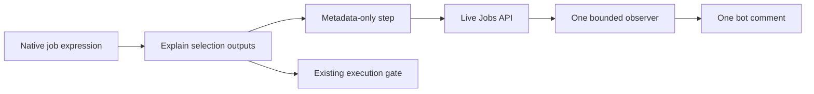

# Live selection reporting

One reporting-only job in [ci-selection-report.yaml](../../../.github/workflows/ci-selection-report.yaml) collects decisions while tests run. It has no `needs`, no test depends on it, and a reporting failure does not fail product checks. It updates the same bot-owned PR comment for the current head. Timing measurements and commit history are outside this report.

## How a decision reaches the comment

1. A job's native expression supplies `candidate`, `eligible`, and `enforced` to [Explain selection](../../../.github/actions/ci-selection-summary/action.yml). That action returns its execution permission and decision.
2. The next step copies those outputs into its display name. Its command is only `:`; it evaluates no selection policy.
3. The observer reads completed metadata steps through the Actions Jobs API, even while their parent test jobs are running. It prints changes to its own log and updates the comment only when its contents change.

The metadata interface is one single-line step name:

```text
CI selection: KIND | TARGET | candidate=BOOL | eligible=BOOL | enforced=BOOL
```

`KIND` is `permitted`, `skipped-by-selection`, or `blocked-by-execution`: the job's execution permission. Each `BOOL` is `true` or `false`. `TARGET` identifies the ordinary job or the adjacent E2E call. The observer validates this shape and displays the recorded `candidate` as Allow or Skip. It does not combine the flags or evaluate selection rules. Missing, malformed, or failed records remain explicit.

The extra no-op step is necessary because GitHub exposes step metadata before a job completes, while downloadable job logs are unsuitable for this early report. GitHub permits the [`steps` context in step names](https://docs.github.com/en/actions/reference/workflows-and-actions/contexts); its [runner expands output-dependent names during execution](https://github.com/actions/runner/blob/main/src/Runner.Worker/ActionRunner.cs). No artifact upload, completed-log download, or duplicated file/label rule is involved.



The observer reads the current head's latest PR run for each workflow. Within a run, the latest attempt of each job name wins; partial reruns retain records for jobs that were not rerun. Matrix jobs keep separate records through their distinct names and job links. Label events start another observer and native job evaluation; the observer itself never interprets labels. Native concurrency cancels an older observer for the same PR.

The invisible marker `<!-- stackrox-native-ci-timing:v1 -->` identifies the existing bot-owned experiment comment. Keeping that identity avoids a second comment. A timing reporter that reads this selection-only body refuses to overwrite it because its timestamp payload is absent. Only `github-actions[bot]` comments qualify; a matching human comment is never edited.

## Bounds and interpretation

The comment contains only workflow/job links and **Selection: Allow or Skip**. Allow means selection requests the job; Skip means selection does not request it. These values describe the recorded file, label, or missing-data fallback rule, independently of execution restrictions. Pending and Unknown identify decisions that are not yet available or lack a usable record.

**Mode** appears once above the table. The reporting workflow's native expression reads `ci-dispatcher-enforce` from its PR event and passes Enforce or Shadow through `--mode`. This is the requested mode for that report; individual workflow guards and older event snapshots still apply. The reporter neither interprets labels nor infers a mode from job records.

Execution details remain in each linked job summary, including whether fork, draft, and required build-label rules permit work. For example, a selected Konflux call shows Allow in the comment even without `konflux-build`; its preparation summary explains why execution is blocked. In Shadow mode, Skip is a recommendation and does not suppress existing execution. Images and later dependencies can still prevent a selected job from running.

The observer checks every five seconds for at most ten minutes after starting its command. The whole job has a twelve-minute timeout. Runner startup, API latency, and runner queues add delay; five seconds is a polling interval, not a delivery guarantee. One runner remains occupied during this bounded window. Conditional GETs reuse unchanged API responses.

For example, a Go job can record permission, start its tests, and appear in the comment at the next observation without waiting for those tests to finish. An E2E preparation can permit a call before images are available. If the image waiter later fails, the call still skips: the record establishes permission, not execution.

The report marks its observation window ended. Decisions made later require rerunning **Live native CI selection log**. A new head stops the old observer; its own run starts a fresh report. API errors and cancellation stop reporting and remain visible in the observer log. The comment does not claim a complete inventory: jobs skipped before any explanation have no record and cannot be assigned a selection reason from a skipped status alone. A report with no records says it is waiting rather than claiming zero selection skips.

Publication is restricted to same-repository PR #23602 and uses its Actions token with `actions: read`, `contents: read`, and `pull-requests: write`. Fork and non-PR events do not start this job. It neither schedules tests nor changes their trust, draft, image, or required-check restrictions.

## Local validation

Local invocations preview once by default and cannot post:

```sh
go run ./ci/native-selectors/selection-report --pr 23602 --sha FULL_HEAD_SHA
go test ./ci/native-selectors/selection-report
go vet ./ci/native-selectors/selection-report
```

The Go command uses the standard library and the existing `gh` CLI. `--repo` defaults to `stackrox/stackrox`; `--mode` accepts Enforce, Shadow, or Unknown (the local default); `--watch` accepts up to `10m`; `--interval` defaults to `5s`; `--run` and `--job` provide the observer log link. `--post` is accepted only inside the authorized Actions experiment. No local test writes to GitHub.

Fake API tests cover publication while tests remain running, changed and unchanged snapshots, bounded observation, latest runs, partial reruns, ownership, malformed metadata, and failures. The selector tests evaluate the actual explanation outputs and metadata expression. Real CI must confirm live step-name visibility, API propagation delay, comment replacement, label-event concurrency, and runner queue behavior.
