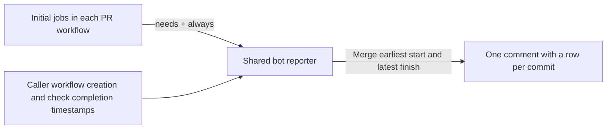

# PR wall-clock wait

This is a temporary experiment for [PR #23602](https://github.com/stackrox/stackrox/pull/23602). The shared workflow publishes only for that PR in `stackrox/stackrox`. Remove this reporting integration before merging the prototype unless a separate decision retains it.

The bot comment reports one measurement for each commit's initial GHA checks:

**Wall-clock wait = latest check completion − earliest workflow creation.**

This includes runner queues, dependency waits, failures, and green skips. Parallel durations are not added together. Timing reporters, canceled workflows/jobs, later label events, and manual reruns are excluded. The start is GitHub's workflow creation time, not the time of the push itself.

For example, workflows running from 12:00–12:10 and 12:05–12:15 produce a **15-minute** wait. A green-skip check finishing at 12:17 extends it to 17 minutes, just as a failed check would.

## How it works

Every PR workflow ends with `report-ci-timing`. Native `needs` lists every other job, and `always()` allows the call after failures or skips. The shared [reporting workflow](../../../.github/workflows/report-ci-timing.yaml) publishes only for `opened` or `synchronize` events on attempt 1 of a same-repository PR. Those conditions live in YAML, so label changes and reruns cannot extend a commit's measurement.



Each reporter reads only its caller's first workflow attempt and job timestamps through `gh api`. It contributes that workflow's start and last non-canceled check completion. Failed checks, successful no-ops, and conditionally skipped checks count regardless of whether they allocated a runner. An unfinished check or missing timestamp causes an error instead of a misleading duration.

The comment stores only `sha`, `start`, and `end` for each commit in hidden JSON. Contributions merge by earliest start and latest finish, so their arrival order does not matter. Old commit rows remain, including after force pushes. There is no scan of other workflows or historical reruns and no round-detection heuristic.

**Values remain provisional while the initial checks and their reporters run.** Each completed workflow updates the same row. Once all initial workflows have reported, it represents the full GHA wait for that commit. If cancellation or a reporting error prevents a contribution, the comment can remain incomplete; it does not independently certify that every workflow reported.

All 23 current PR workflows have the final call; only workflows triggered by the initial opening/new-commit event contribute. A structural test checks every dependency list. Add a new job to its workflow's reporter `needs`; add the final call when adding a PR workflow. Existing test selection, image prerequisites, and required test checks retain their rules.

## One bot comment

The invisible marker `<!-- stackrox-native-ci-timing:v1 -->` identifies the comment. Only a matching comment owned by **github-actions[bot]** can be updated. Another hidden marker holds the timestamp data. Malformed data is rejected, and unchanged contents cause no edit.

GitHub job concurrency serializes comment creation and updates per PR. `queue: max` retains pending publishers. The automatic `${{ github.token }}` token supplies Actions/contents read and PR write permissions only to reporting jobs. Forks skip publication; drafts in the same repository can report. Failures in reporting are advisory. No personal token is used.

Reporting adds runner usage and delays workflow completion while publishing; that overhead is excluded from the displayed wait. No polling, service, or default-branch workflow is needed. Actual bot permissions, concurrency, and cancellation behavior still require a real PR run.

## Interface and local validation

The Go helper accepts `--repo owner/repository` (default `stackrox/stackrox`), `--pr NUMBER`, and `--run WORKFLOW_RUN_ID`. Local execution previews the selected first attempt without publishing:

```sh
go run ./ci/native-selectors/timing-report --pr 23602 --run 39939959551
```

`--post` is supported only inside GitHub Actions with its workflow token. The shared workflow supplies the caller's `$GITHUB_RUN_ID`. The helper uses Go 1.26.7's standard library and the existing GitHub CLI; it adds no module and never selects or dispatches tests.

```sh
go test ./ci/native-selectors/timing-report
go vet ./ci/native-selectors/timing-report
go -C ci/native-selectors/testing test -run TestTimingWorkflowIntegration -v
```

Tests use simulated API responses and never post comments. They cover wall-clock aggregation across parallel workflows, failures, green skips, cancellations, reporter exclusion, pagination, history merging, bot ownership, publication guards, and the native conditions excluding labels and reruns.
